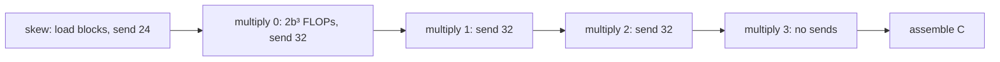

# Cannon's Algorithm

The Python entry points are `matmul` and `matmul_traced` in
`python/dmm/algorithms/cannon.py`; computation lives in `src/cannon.cpp` on the
BSP runtime in `src/bsp.cpp`. See the [overview](overview.md) for availability.

## Cannon's logical block grid

Cannon accepts P=q² and c=1. The schedule below illustrates the default
P=16 (q=4); other square P use q rounds. Each $N \times N$ input is divided
into q×q blocks with dimension b=N/q. The grid runs as 16 logical nodes; node $(i,j)$ has id
$4i+j$ and owns the blocks $A$, $B$ and $C_{ij}$ it currently holds. Output
block $(i,j)$ accumulates four products:

$$
k_s=(i+j+s)\bmod 4,\qquad
C_{ij}=\sum_{s=0}^{3}A_{i,k_s}B_{k_s,j}.
$$

For output block (1, 2), the shared indices are 3, 0, 1 and 2. Each index is
visited exactly once. The 16 logical nodes are independent of the worker count.

## Supersteps and message routes

Cannon runs five supersteps on `Bsp(16)`. Grid coordinates are taken modulo 4.
A blocks use tag 0 and B blocks tag 1. Messages sent in one superstep are
received at the start of the next.

1. `skew`: each node copies its own $A_{ij}$ and $B_{ij}$ out of the input and
   zeroes its $C$ tile. This initial distribution is not counted as
   communication. $A_{ij}$ is sent to $(i, j-i)$ and $B_{ij}$ to $(i-j, j)$;
   row 0 of A and column 0 of B stay put, so 12 A and 12 B blocks move.
2. `multiply` rounds $s=0,\dots,3$: each node receives the blocks sent to it
   (in round 0, A from $(i, j+i)$ and B from $(i+j, j)$, where present; later,
   A from $(i, j+1)$ and B from $(i+1, j)$). It accumulates
   $A_{i,k_s}B_{k_s,j}$ using the shared blocked FP32 `gemm_add` kernel (tile 32) and records
   $2b^3$ FLOPs. In rounds 0–2 it sends A to its left neighbour $(i, j-1)$
   and B to its upper neighbour $(i-1, j)$; round 3 sends nothing.
3. After the last superstep, the caller assembles the 16 C tiles into a newly
   allocated `Matrix<float>`; the binding copies it into a NumPy array.

For example, node (1, 2) = 6 skews A to (1, 1) = 5 and B to (3, 2) = 14, then
in each shift round sends A to (1, 1) and B to (0, 2). Node (0, 0) keeps both
blocks during the skew.

The accumulation order per output element is the same as in the earlier
block-view implementation, so FP32 results are unchanged.

## Hand-computed communication counts

Words are FP32 values; a multiply-add counts as 2 FLOPs. $h$ is the larger of
a node's sent and received words in a superstep, and $F$ its FLOPs.

| Superstep | Messages | Total words | max h | max F |
| --- | --- | --- | --- | --- |
| skew | 24 | $24b^2$ | $2b^2$ | 0 |
| multiply 0–2 | 32 each | $32b^2$ each | $2b^2$ | $2b^3$ |
| multiply 3 | 0 | 0 | 0 | $2b^3$ |
| **total** | 120 | $120b^2$ | $8b^2$ | $8b^3$ |

Over the 5 supersteps, `count(trace)` therefore reports 120 messages,
$120b^2$ total words, $8b^2$ critical words, $8b^3$ critical FLOPs and
$128b^3 = 2N^3$ total FLOPs. With the [BSP cost model](../design.md#communication-model),

$$
T_{BSP} = 8b^3\,w + 8b^2\,g + 5\,l.
$$

GoogleTest checks these counts for $N = 4, 8, 12$ and individual message
routes; pytest checks them through `matmul_traced`.

## Nodes and workers

Each node's task touches only its own A/B/C buffers and mailbox; data crosses
nodes only through copied messages. Block views (`Matrix<T>::block`) are used
only to copy each node's initial blocks out of the input matrices.

Each superstep is one synchronous `Executor::for_each` batch of 16 tasks, so a
call submits five batches. Workers have no permanent grid coordinate and may
run several nodes per batch. Message delivery runs on the caller between
batches. No sleep or delay models the network: wall-clock time includes
message copies, while network cost comes from the counts and the parameters
$g$ and $l$.

Cannon local tiles and message buffers use tracked `Buffer` storage; peak words
are exposed per node and superstep. Common row-slice conversion, 1D ring and
2.5D integration remain future work.

## Input and output contract

- Matching, finite, non-empty square NumPy arrays of dtype `float32`.
- Positive integer dimension divisible by q=sqrt(P); unsupported sizes fail preflight.
- Arbitrary strides and read-only arrays are accepted and preserved.
- A fresh FP32 result with independent storage is returned on every call;
  `matmul_traced` also returns a new `Trace`.
- FP32 rounding depends on the prescribed stage order. Correctness uses an
  independent FP64 reference with [numerical tolerances](../experiments.md#correctness-and-arithmetic).

The algorithm object carries P/c but has no mutable execution state. It borrows A/B and an executor for each call;
it owns neither persistent matrices nor workers. Each call creates its own BSP
machine. Repeated calls do not alter previously returned products or traces.
