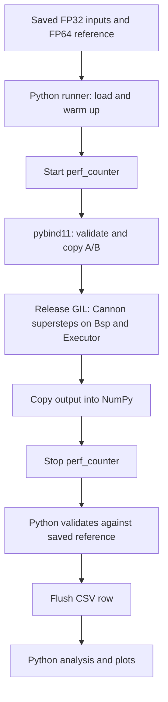

# System Design

## Modules and data flow

Python owns experiment orchestration. C++ owns matrix storage, block views,
the BSP communication runtime, Cannon arithmetic and serial/thread execution.

| Path | Responsibility |
| --- | --- |
| `python/dmm/__init__.py` | Set numerical-library thread environment variables to one |
| `python/dmm/config.py` | Load YAML, resolve paths and validate settings |
| `python/dmm/datasets.py` | Generate and load shared FP32 inputs and independent FP64 references |
| `python/dmm/benchmark.py` | Manage cases, warmups, timing, validation and CSV/JSON |
| `python/dmm/analysis.py` | Validate results, report median/IQR, calculate speedup and plot |
| `python/dmm/cli.py` | Expose generate, bench and analyze commands |
| `python/dmm/execution.py` | Re-export bound C++ executor classes |
| `python/dmm/bsp.py` | Re-export bound trace records, `count` and `bsp_cost` |
| `python/dmm/algorithms/cannon.py` | Validate supported sizes and call the plain or traced binding |
| `src/bindings.cpp` | Validate/copy NumPy inputs, release the GIL, return NumPy output and traces |
| `include/dmm/algorithm.hpp` | Define Matrix, MatrixBlockView and Algorithm concept |
| `src/bsp.cpp` | Run logical-node supersteps, deliver copied messages, count and cost traces |
| `src/cannon.cpp` | Skew and shift blocks between P nodes, multiply, assemble, validate native results |
| `src/execution.cpp` | Dispatch tasks synchronously or through persistent C++ threads |

## Dataset and algorithm boundaries

Dataset generation computes references once, before benchmarking. The runner
loads A/B/reference once per algorithm/group/size within an execution setting,
marks inputs read-only and reuses them across warmups and measured repeats.
One executor is reused across all cases for a mode/worker count.

Each YAML case selects layout/P/c. The dispatcher imports `ring`, `cannon` or
`two_point_five_d` under `dmm.algorithms` according to layout. Every implementation exposes
`validate_size(size, *, P, c)` and `matmul(A, B, executor, *, P, c)`. Size preflight must not allocate
matrices or start workers. The algorithm returns a fresh FP32 array and preserves
its inputs. Timing, reference comparison and file writing belong to the runner.

The native contract is a const algorithm object carrying P/c with
`Matrix<float> matmul(const Matrix<float>&, const Matrix<float>&, Executor&) const`.
`Algorithm<T>` checks that contract at compile time. `TracedAlgorithm<T>`
additionally requires `Traced run(...) const`, returning the product with its
BSP trace. Cannon is a plain struct satisfying both; there is no algorithm
inheritance hierarchy. See the [C++ reference](api/cpp.md).

## Communication model

The proposal's BSP cost model is

$$
T_{BSP} = w\sum_s \max_r F(r,s) + g\sum_s \max_r h(r,s) + l\,S,
$$

where $F(r,s)$ is node $r$'s FLOPs in superstep $s$, $h(r,s)$ the larger of its
sent and received FP32 words, and $S$ the number of supersteps.

`dmm::Bsp` in `include/dmm/bsp.hpp` is algorithm-independent; 1D ring and 2.5D
are planned to use it unchanged. `Bsp(P).superstep(label, executor, body)` runs
`body(Node&)` once per logical node, then delivers the messages. Inside `body`
a node may `send(destination, tag, payload)` (copying the payload),
`receive(source, tag, words)` a message delivered at the end of the previous
superstep, and `compute(flops)` to record local work. Node code reads and
writes only its own storage; data crosses nodes only through messages.

The runtime rejects invalid destinations and sources, self-sends, duplicate
`(source, destination, tag)` messages within one superstep and wrong received
lengths. Every delivered message must be received in the next superstep;
`finish()` checks the last one and returns the `Trace` of per-superstep labels,
per-node FLOPs and message records.

`count` turns a trace or one superstep into `Counts`; `bsp_cost` evaluates the
formula above for given $w$, $g$ and $l$. No sleep or busy-wait injects network
time: wall-clock measures only real computation and copies, while $g$ and $l$
are model parameters, so a parameter sweep recomputes costs from saved counts
without rerunning. Common row-slice input/output conversion and per-node peak
memory are not implemented yet.

## Binding and ownership

The Python executor objects directly bind C++ classes; there is no separate
Python worker implementation. Input validation checks finite, non-empty square
FP32 arrays. The binding copies arbitrary input strides into owned row-major
`Matrix<float>` storage and allocates an independent NumPy output.

Computation and output copying run with the GIL released. Each node copies its
initial blocks out of the copied input matrices through block views, and every
message copies its payload. Entering C++ copies A/B, and returning copies the
product into NumPy. All these copies are inside the measured call.
`cannon_traced` also returns the trace as bound `Trace` objects.

## Executors

The C++ abstract `Executor` exposes synchronous `for_each(count, task)`.
Each task receives its index. The call returns after all tasks complete and
propagates errors. Algorithm code borrows the executor and does not start or
close it. The BSP runtime submits one batch per superstep, with one task per
logical node, and delivers messages on the caller between batches; Cannon
therefore submits q+7 batches of P tasks on the common route for P>1.

| Executor | Behavior |
| --- | --- |
| `SerialExecutor()` | Run tasks on the caller's thread |
| `ThreadExecutor(workers)` | Start persistent C++ threads at construction |

`make_executor(0)` selects serial execution in C++; positive counts select
threads. Python's direct constructor also checks the available logical CPU
count. Benchmark YAML imposes its additional maximum of six workers.

The thread pool statically distributes task indices among workers and waits
for the batch. Concurrent calls sharing an executor serialize their batches.
Ordinary task exceptions propagate; the pool can process another batch.

Context entry rejects nested entry and closed pools. Context exit, explicit
`close()` and destruction close workers. Close is idempotent and waits for an
active batch. A closed executor cannot be reopened. Startup and shutdown occur
outside measurement.

## Numerical-library threads

Package import sets OMP, MKL, OpenBLAS, Accelerate and NumExpr thread limits to
one. Import `dmm` before NumPy when embedding the package; changing environment
variables after initialization may not reconfigure an existing library pool.
Cannon uses the shared blocked C++ kernel and does not call BLAS.

## Verification

`tests/cpp/` separates Matrix, MatrixBlockView, BSP, Cannon and Executor
GoogleTest cases, including BSP delivery and protocol checks and Cannon's
hand-computed counts and message routes. `tests/python/` covers configuration, datasets, measurement boundaries,
bindings, input/output ownership, CLI and analysis. The documentation generator
has separate tests in `doc/tests/`. See [contribution checks](contribute.md#verification).

## Shared local arithmetic

All layouts use `gemm_add` in `include/dmm/gemm.hpp`: rectangular FP32
C += A*B with row strides, fixed tile 32, tail handling and no allocation.
Logical node blocks are separate from local kernel tiles.
See the [framework contract](framework.md) for completed and remaining work.

## Tree communication

Fixed heap-tree broadcast and sum reduction are implemented in `collectives.hpp`.
Independent disjoint groups share each tree level rather than running serially.
All payloads go through BSP messages and reduction additions are counted.
See the [collective API](api/cpp.md#fixed-tree-collectives) for numbering,
superstep semantics and hand-counted examples.

## Payload lifecycle

Node-local and mailbox payload use move-only `Buffer` objects with per-node
ledgers. Explicit send copies increase the source peak; delivery moves ownership
to the destination and receive transfers storage without a duplicate allocation.
Per-step and trace peaks are exposed in FP32 words. See the
[memory contract](api/cpp.md#node-payload-ownership-and-peak-memory).

## Common input and output

Cannon now routes through node-owned row shards and two-step BSP conversion
in each direction; both A and B inputs convert separately. Original sizes pad
to a common multiple of P and the output crops after returning row shards.
Messages carry global element rectangles. The native body metric excludes only
input/output conversion using `count_native`, with the same padded arithmetic.
See [Cannon phases](algorithms/cannon.md#supersteps-and-message-routes).
