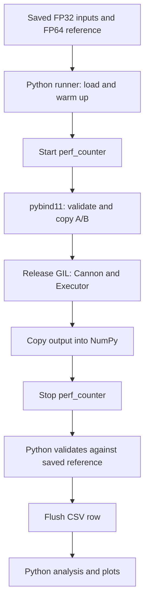

# System Design

## Modules and data flow

Python owns experiment orchestration. C++ owns matrix storage, block views,
Cannon arithmetic and serial/thread execution.

| Path | Responsibility |
| --- | --- |
| `python/dmm/__init__.py` | Set numerical-library thread environment variables to one |
| `python/dmm/config.py` | Load YAML, resolve paths and validate settings |
| `python/dmm/datasets.py` | Generate and load shared FP32 inputs and independent FP64 references |
| `python/dmm/benchmark.py` | Manage cases, warmups, timing, validation and CSV/JSON |
| `python/dmm/analysis.py` | Validate results, average samples, calculate speedup and plot |
| `python/dmm/cli.py` | Expose generate, bench and analyze commands |
| `python/dmm/execution.py` | Re-export bound C++ executor classes |
| `python/dmm/algorithms/cannon.py` | Validate supported sizes and call the binding |
| `src/bindings.cpp` | Validate/copy NumPy inputs, release the GIL and return NumPy output |
| `include/dmm/algorithm.hpp` | Define Matrix, MatrixBlockView and Algorithm concept |
| `src/cannon.cpp` | Build tasks, compute and assemble FP32 tiles, validate native results |
| `src/execution.cpp` | Dispatch tasks synchronously or through persistent C++ threads |

## Dataset and algorithm boundaries

Dataset generation computes references once, before benchmarking. The runner
loads A/B/reference once per algorithm/group/size within an execution setting,
marks inputs read-only and reuses them across warmups and measured repeats.
One executor is reused across all cases for a mode/worker count.

Python dynamically imports `dmm.algorithms.<name>`. Every implementation exposes
`validate_size(size)` and `matmul(A, B, executor)`. Size preflight must not allocate
matrices or start workers. The algorithm returns a fresh FP32 array and preserves
its inputs. Timing, reference comparison and file writing belong to the runner.

The native contract is a const, stateless algorithm object with
`Matrix<float> matmul(const Matrix<float>&, const Matrix<float>&, Executor&) const`.
`Algorithm<T>` checks that contract at compile time. Cannon is a plain struct;
there is no algorithm inheritance hierarchy. See the [C++ reference](api/cpp.md).

## Binding and ownership

The Python executor objects directly bind C++ classes; there is no separate
Python worker implementation. Input validation checks finite, non-empty square
FP32 arrays. The binding copies arbitrary input strides into owned row-major
`Matrix<float>` storage and allocates an independent NumPy output.

Computation and output copying run with the GIL released. Borrowed block views
refer to the copied input matrices, which remain alive until the call completes.
Views do not copy elements; entering C++ still copies A/B, and returning copies
the product into NumPy. All these copies are inside the measured call.

## Executors

The C++ abstract `Executor` exposes synchronous `for_each(count, task)`.
Each task receives its index. The call returns after all tasks complete and
propagates errors. Algorithm code borrows the executor and does not start or
close it.

| Executor | Behavior |
| --- | --- |
| `SerialExecutor()` | Run tasks on the caller's thread |
| `ThreadExecutor(workers)` | Start persistent C++ threads at construction |

`make_executor(0)` selects serial execution in C++; positive counts select
threads. Python's direct constructor also checks the available logical CPU
count. Benchmark YAML imposes its additional maximum of six workers.

The thread pool statically distributes task indices among workers and waits
for the batch. Concurrent calls sharing an executor serialize their batches.
Ordinary task exceptions propagate; the pool can process another batch.

Context entry rejects nested entry and closed pools. Context exit, explicit
`close()` and destruction close workers. Close is idempotent and waits for an
active batch. A closed executor cannot be reopened. Startup and shutdown occur
outside measurement.

## Numerical-library threads

Package import sets OMP, MKL, OpenBLAS, Accelerate and NumExpr thread limits to
one. Import `dmm` before NumPy when embedding the package; changing environment
variables after initialization may not reconfigure an existing library pool.
Cannon uses scalar C++ loops and does not call BLAS.

## Verification

`tests/cpp/` separates Matrix, MatrixBlockView, Cannon and Executor GoogleTest
cases. `tests/python/` covers configuration, datasets, measurement boundaries,
bindings, input/output ownership, CLI and analysis. The documentation generator
has separate tests in `doc/tests/`. See [contribution checks](contribute.md#verification).
