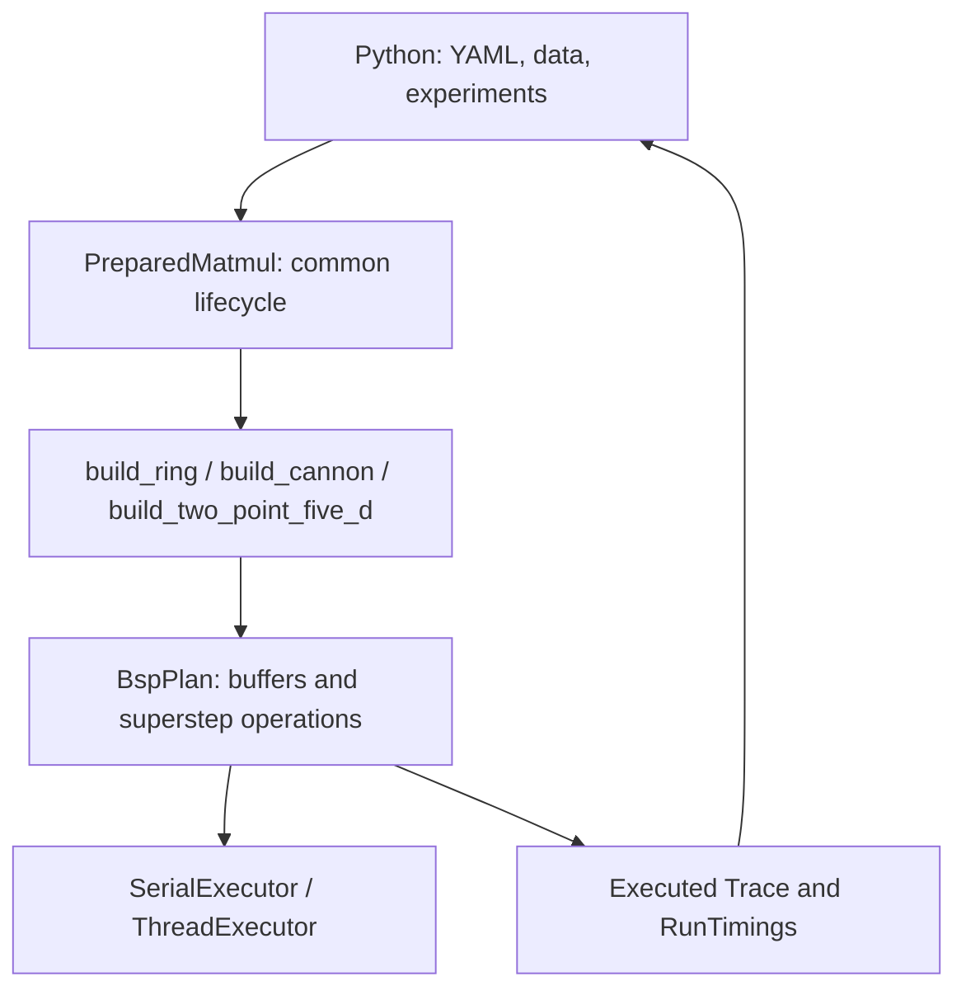

# System design

## Modules and data flow

The system has one BSP operation interpreter. Algorithms build a fixed plan;
Python runs experiments and reports actual traces and timings. There is no
algorithm inheritance hierarchy, compiler optimizer or second callback runtime.

| Files | Responsibility |
| --- | --- |
| `matmul.hpp`, `src/matmul.cpp` | Common input ownership, reset, cropped output, locking and lifecycle |
| `plan.hpp`, `src/plan_build.cpp` | Public DSL, typed views, validation and endpoint matching |
| `src/plan_execute.cpp` | Interpret finalized operations through the executor |
| `algorithms.hpp`, `src/algorithms/` | Builder declarations, selection and each algorithm's schedule |
| `redistribution.hpp`, `collectives.hpp` | Shared row/tile conversions and fixed binary trees |
| `trace.hpp`, `src/trace.cpp`, `validation.hpp`, `src/validation.cpp` | Executed records, counts, costs, coverage and FP64 checks |
| `detail/gemm.hpp`, `detail/memory.hpp` | Internal common kernel and tracked payload storage |
| `execution.hpp`, `src/execution.cpp` | Synchronous serial execution and persistent thread pool |
| `src/bindings.cpp`, `python/dmm/matmul.py` | Common NumPy/binding entry points |
| `python/dmm/config.py`, `datasets.py` | YAML cases, shared FP32 data and independent FP64 oracle |
| `python/dmm/trace.py` | Serialization, saved-trace validation, manifest checks and offline loading |
| `python/dmm/model.py`, `measurement.py` | Model scenarios and prepared calibration/measurements |
| `python/dmm/benchmark.py`, `analysis.py` | Convenience API timing and summary/plots |

## Dataset and algorithm boundaries

Each case explicitly supplies layout, P and c. P logical nodes are independent
of H physical worker threads. Ring, Cannon and 2.5D share the builder contract.

A builder has signature
`MatmulDefinition build_xxx(BspPlan&, const MatmulConfig&)`. It receives immutable
padded_size/P/c, allocates owned buffers and returns three row-view lists and a
product grid. Names describe their boundaries: `input_a_rows`, `input_b_rows`,
`output_c_rows`. Each view has shape N/P×N; native tiles can reuse that storage
or extra capacity. The builder declares operations in sequence and returns. It
does not restore input, gather output, finalize, execute or generate reports.

`PreparedMatmul` owns input copies and the completed plan. Construction validates
inputs, invokes the builder and finalizes the plan. Each `run_into` restores inputs,
executes the finalized plan, then gathers/crops the output. C zeroing is declared
inside the plan and executes on every call. `trace()` requires a successful run;
a failed execution invalidates the snapshot until a successful retry.

Ordinary calls create this same workspace temporarily. Prepared calls retain it.
Both use identical schedules, communication, coverage and memory accounting.
The Python layout modules forward to the shared API. The C++ entry points
select a builder in `src/algorithms/registry.cpp`. Each layout supplies one
builder function and uses the same execution path.

## Communication model

`BspPlan` creates checked views and appends `Superstep` handles. The handles
register `add_zero`, `add_copy`, `add_receive`, `add_receive_sum`, `add_gemm` and
`add_send`. Each node's copies precede GEMMs, then sends; only the newest step
can be extended. This prevents an apparently sequential declaration from being
silently reordered by execution batches.

Source and destination ownership determine message endpoints. Matching uses the
sending step and ordered node pair, with one logical message per pair per step
and exactly one receive in the next step. Several components share one ordered
bundle. There are no public tags or message IDs. Component shapes/order are
validated at finalization; global origins annotate trace regions only. Equal
shapes cannot reveal swapped semantic components, so A/B ordering remains an
explicit positional contract. See the [C++ examples](api/cpp.md#bsp-operation-plan).

Finalization validates the schedule and prepares cached slots. The interpreter
executes three blocking batches per step: copies/receives, kernels, sends. All
cross-node payloads are copied; self-owned data stays local. Execution generates
actual trace records. It does not generate native code.

The model uses

$$
T = w\sum_s\max_r F(r,s) + g\sum_s\max_r h(r,s) + lS,
$$

where h is the larger of sent and received FP32 words. S counts logical
supersteps, not executor batches. Executed GEMMs and reduction additions record
FLOPs; real message copies record traffic. No sleep emulates a network. Saved
traces can be reused for gamma/lambda sweeps without running matrix arithmetic.
`count_native(trace)` excludes only input/output conversion from the same run;
there is no separate native-input execution mode.

Node payload capacity, including retained caches and scratch, is tracked per
node even when idle. `peak_words` is a maximum, not the sum of all nodes. Host
input/output storage and metadata are outside this logical-node metric. Coverage
validation checks every block triple exactly once without expanding scalar n³
terms. Neither metadata nor a model formula establishes numerical correctness;
results are also checked against FP64.

## Binding and ownership

`dmm.matmul` provides common `validate_size`, `prepare`, `matmul` and
`matmul_traced` functions with explicit layout/P/c. Layout modules may forward
to them to preserve existing runner discovery. There is one bound
`PreparedMatmul` class, one common prepare implementation and one output protocol.

Inputs must be finite, nonempty matching FP32 square arrays. Read-only and
strided arrays are copied into owned storage. Prepared execution is unaffected
by subsequent changes to caller inputs. Ordinary output is independent storage;
prepared output is caller-allocated, writable, C-contiguous FP32 of original
shape. GIL release surrounds execution and trace access. A workspace mutex
serializes reset, execution and gathering.

## Executors

`Executor::for_each(count, task)` runs a synchronous batch and propagates task
errors. Serial uses the caller thread; threaded uses persistent std::threads
with static round-robin distribution. P>H therefore works without changing the
logical schedule. Workspaces borrow the executor and never start nested pools.
Concurrent batches sharing an executor serialize. Closing waits for an active
batch; close is idempotent and a closed pool cannot reopen. Worker startup and
shutdown are outside prepared measurements.

## Measurement and verification

Prepared internal timing covers common row shards to common row shards,
including zeroing, conversions, computation, copies and scheduling. Allocation,
host input restoration, output assembly, validation and report writes are
outside. Convenience `bench` measures the whole API call and has a different
boundary. See [measurement](measurement.md).

Tests cover independent FP64 results, hand-counted routes, missing/duplicate
coverage, per-node memory, ownership, padding, no allocation on caller/workers,
repeated execution and recovery after executor failure. See
[contribution checks](contribute.md#verification) and [C++ contracts](api/cpp.md).
