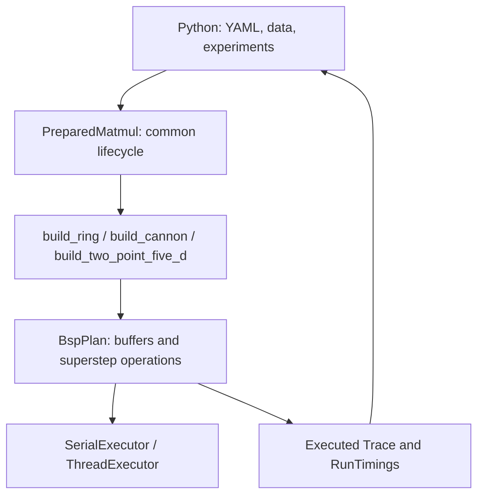

# System design

## Modules and data flow

The system has one BSP operation interpreter. Algorithms build a fixed plan;
Python runs experiments and reports actual traces and timings. There is no
algorithm inheritance hierarchy, compiler optimizer or second callback runtime.

| Files | Responsibility |
| --- | --- |
| `matmul.hpp`, `src/matmul.cpp` | Common input ownership, reset, cropped output, locking and lifecycle |
| `bsp_plan.hpp`, `src/bsp_plan.cpp` | Build, validate and interpret superstep operations |
| `src/cannon.cpp` | Cannon's buffer declarations and schedule |
| `sharding.hpp`, `collectives.hpp` | Shared layout conversions and fixed binary trees |
| `bsp.hpp`, `src/bsp.cpp`, `coverage.cpp` | Trace types, critical counts, cost and coverage validation |
| `execution.hpp`, `src/execution.cpp` | Synchronous serial execution and persistent thread pool |
| `src/bindings.cpp`, `python/dmm/matmul.py` | Common NumPy/binding entry points |
| `python/dmm/config.py`, `datasets.py` | YAML cases, shared FP32 data and independent FP64 oracle |
| `python/dmm/model.py`, `measurement.py` | Model replay and prepared measurement/calibration |
| `python/dmm/benchmark.py`, `analysis.py` | Convenience API timing and summary/plots |

## Dataset and algorithm boundaries

Each case explicitly supplies layout, P and c. P logical nodes are independent
of H physical worker threads. Only Cannon is implemented; missing teammate
layouts fail before execution.

A builder has the ordinary function signature
`void build_xxx(BspPlan&, MatmulLayout&)`. It receives the padded size and P/c,
allocates its node buffers, binds `layout.a`, `layout.b` and `layout.result` to
common row-shard storage, sets coverage and appends operations. A row buffer can
have extra capacity and be reused as a native tile. This preserves Cannon's
in-place conversions and payload peaks. The builder does not restore input,
collect output, acquire locks, call an executor or generate CSVs.

`PreparedMatmul` owns input copies and the completed plan. Construction validates
inputs, invokes the builder and seals the plan. Each `run_into` restores inputs,
executes the sealed plan, then gathers/crops the output. C zeroing is declared
inside the plan and executes on every call. `trace()` requires a successful run;
a failed execution invalidates the snapshot until a successful retry.

Ordinary calls create this same workspace temporarily. Prepared calls retain it.
Both use identical schedules, communication, coverage and memory accounting.
The legacy C++ `Cannon` facade and Python `algorithms.cannon` module are thin
wrappers; new algorithms do not need corresponding workspace classes.

## Communication model

`BspPlan` records `zero`, local `copy`, `receive`, `multiply_add` and `send`.
`seal` validates the schedule and prepares cached message slots. Execution
interprets the operation lists; it does not generate native code. Each logical
superstep has three blocking executor batches: local/received copies, kernels,
then outgoing copies. Every message is received exactly once in the immediately
following superstep. Self-owned data stays local. Foreign storage, duplicate
messages, incorrect views and undrained messages are rejected.

The model uses

$$
T = w\sum_s\max_r F(r,s) + g\sum_s\max_r h(r,s) + lS,
$$

where h is the larger of sent and received FP32 words. S counts logical
supersteps, not executor batches. Executed GEMMs and reduction additions record
FLOPs; real message copies record traffic. No sleep emulates a network. Saved
traces can be reused for gamma/lambda sweeps without running matrix arithmetic.
`count_native(trace)` excludes only input/output conversion from the same run;
there is no separate native-input execution mode.

Node payload capacity, including retained caches and scratch, is tracked per
node even when idle. `peak_words` is a maximum, not the sum of all nodes. Host
input/output storage and metadata are outside this logical-node metric. Coverage
validation checks every block triple exactly once without expanding scalar n³
terms. Neither metadata nor a model formula establishes numerical correctness;
results are also checked against FP64.

## Binding and ownership

`dmm.matmul` provides common `validate_size`, `prepare`, `matmul` and
`matmul_traced` functions with explicit layout/P/c. Layout modules may forward
to them to preserve existing runner discovery. There is one bound
`PreparedMatmul` class, one common prepare implementation and one output protocol.

Inputs must be finite, nonempty matching FP32 square arrays. Read-only and
strided arrays are copied into owned storage. Prepared execution is unaffected
by subsequent changes to caller inputs. Ordinary output is independent storage;
prepared output is caller-allocated, writable, C-contiguous FP32 of original
shape. GIL release surrounds execution and trace access. A workspace mutex
serializes reset, execution and gathering.

## Executors

`Executor::for_each(count, task)` runs a synchronous batch and propagates task
errors. Serial uses the caller thread; threaded uses persistent std::threads
with static round-robin distribution. P>H therefore works without changing the
logical schedule. Workspaces borrow the executor and never start nested pools.
Concurrent batches sharing an executor serialize. Closing waits for an active
batch; close is idempotent and a closed pool cannot reopen. Worker startup and
shutdown are outside prepared measurements.

## Measurement and verification

Prepared internal timing covers common row shards to common row shards,
including zeroing, conversions, computation, copies and scheduling. Allocation,
host input restoration, output assembly, validation and report writes are
outside. Convenience `bench` measures the whole API call and has a different
boundary. See [measurement](measurement.md).

Tests cover independent FP64 results, hand-counted routes, missing/duplicate
coverage, per-node memory, ownership, padding, no allocation on caller/workers,
repeated execution and recovery after executor failure. See
[contribution checks](contribute.md#verification) and [C++ contracts](api/cpp.md).
