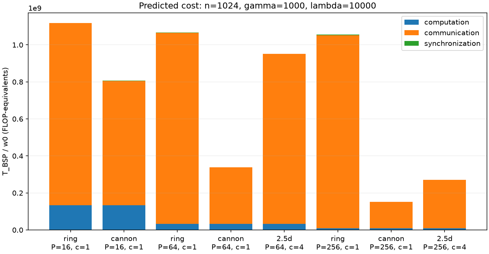
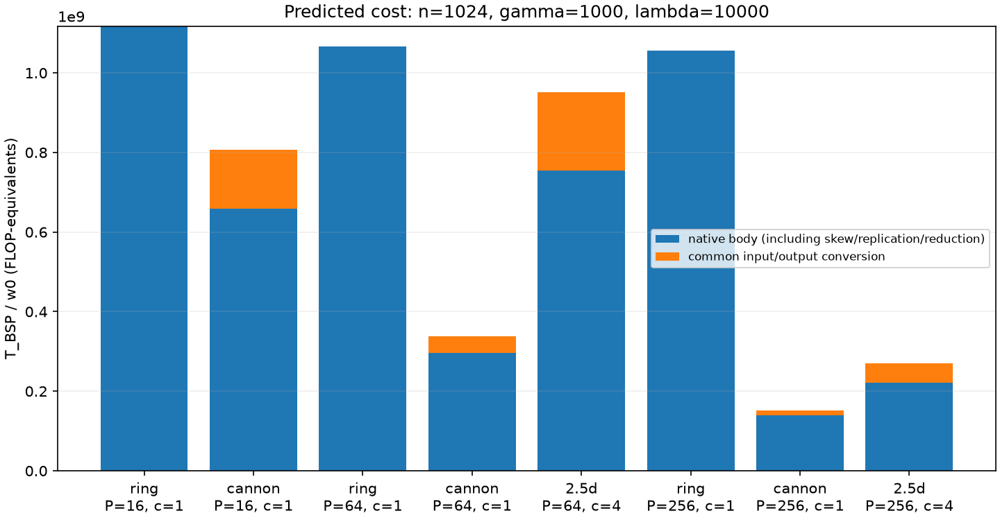
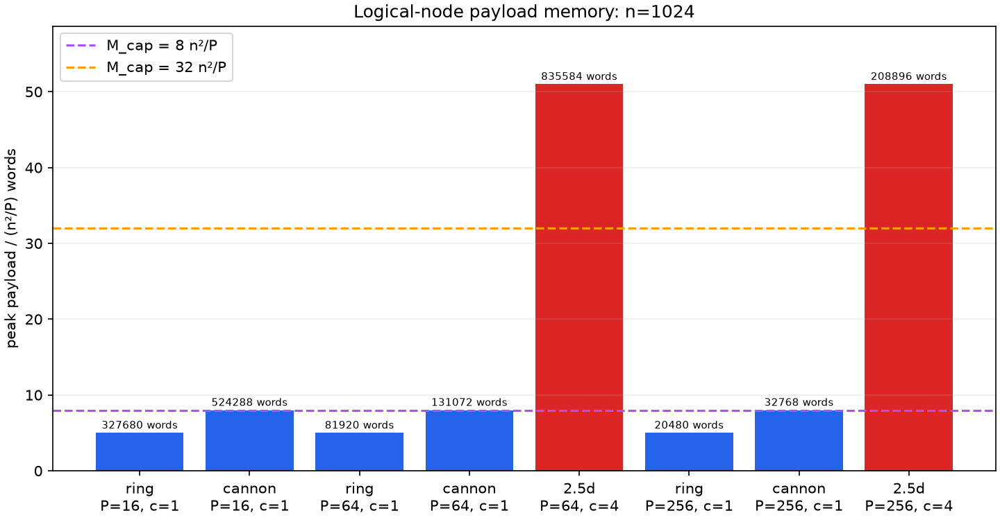
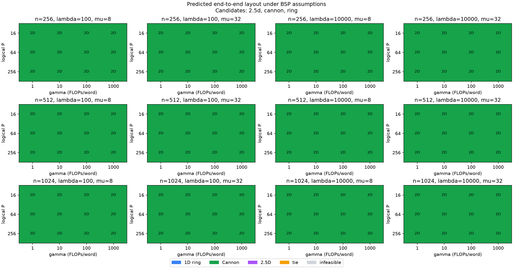
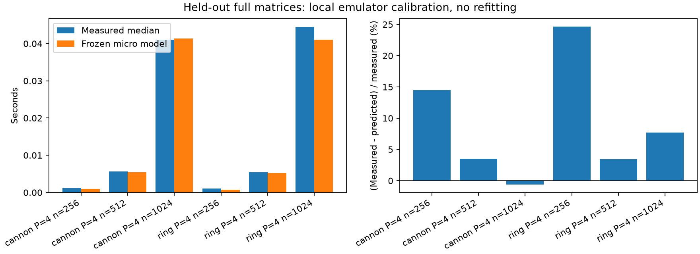

# Results and Discussion

The formal run used commit `9fc781b` and the frozen design in Sections 4–6 of the
proposal. Ring, Cannon and 2.5D ran on the same FP32 inputs for each size. All
24 main configurations and nine padding configurations passed the independent
FP64 reference check. The largest Frobenius relative error on the main grid
was approximately 4.27 × 10⁻⁷. The release includes the executed traces, CSVs,
calibration records, figures and YAML profiles. [Project proposal](proposal.md) ·
[Experiment results archive](https://github.com/ceg5206-g7/dmm/releases/tag/experiment-results-9fc781b)

## Communication and BSP cost

The main grid used matrix sizes 256, 512 and 1024 with logical node counts
16, 64 and 256. Ring and Cannon ran at each node count. The 2.5D cases used
`c=4` at `P=64/256`. The normalized BSP cost was
`W_crit + gamma × C_crit + lambda × S`. Total communication counts the words
sent across the system. Critical communication sums, over supersteps, the
largest send or receive volume on any node. A reduction in total traffic can
therefore coincide with a higher modeled communication cost.

**Table 1.** Executed communication and synchronization at `n=1024`.
Communication columns are normalized by the units in their headers. The native
body includes skew, replication and reduction where applicable. The common
route also includes input and output layout conversion.

| P | Layout | Common total words / n² | Native critical words / (n²/P) | Common critical words / (n²/P) | Supersteps, native → common |
| ---: | --- | ---: | ---: | ---: | ---: |
| 16 | Ring | 15.00 | 15.00 | 15.00 | 16 → 16 |
| 16 | Cannon | 9.75 | 8.00 | 10.25 | 5 → 11 |
| 64 | Ring | 63.00 | 63.00 | 63.00 | 64 → 64 |
| 64 | Cannon | 18.38 | 16.00 | 18.63 | 9 → 15 |
| 64 | 2.5D | 17.95 | 44.00 | 56.00 | 8 → 14 |
| 256 | Ring | 255.00 | 255.00 | 255.00 | 256 → 256 |
| 256 | Cannon | 34.69 | 32.00 | 34.81 | 17 → 23 |
| 256 | 2.5D | 26.99 | 52.00 | 64.00 | 9 → 15 |

Ring works directly on the common row distribution and sends a B shard in each
of its first `P−1` rounds. Cannon's 2D block shifts lower critical communication
and reduce the number of supersteps at every tested `P`, even after adding six
conversion supersteps. Both layouts perform the same total and critical
arithmetic work at a given `n` and `P`.

Replication reduces communication inside the multiply phase. At `P=256` the
2.5D multiply phase contributes 8 units of critical words in Table 1's
normalization, compared with 30 for Cannon. For 2.5D, replication adds 24 units,
skew adds 8, reduction adds 12 and layout conversion adds 12. The common 2.5D
route consequently sends 22.2% fewer total words than Cannon and incurs 83.8%
more critical words. The layer reduction adds `(c−1)n²` scalar additions.
[Figure 1](#figure-1) separates arithmetic, communication and synchronization
costs. [Figure 2](#figure-2) shows the added conversion cost. The underlying
values are in `results/model/model.csv` and `results/model/phase_model.csv` in
the release.

### Figure 1

*Modeled computation, communication and synchronization costs at `n=1024`,
`gamma=1000` and `lambda=10000`. The bars show costs before budget filtering.*

### Figure 2

*Native body and common-route conversion costs from the same executed traces
and parameter slice as Figure 1.*

## Memory budgets and layout selection

The peak logical-node payload was 5, 8 and 51 units of `n²/P` words for Ring,
Cannon and 2.5D, respectively. This metric includes row shards, local tiles
and retained message buffers. The 2.5D result includes separate row and tile
storage at `c=4`. Cannon fits the tighter budget exactly. Both tested 2.5D
grids exceed the two proposal budgets, `8n²/P` and `32n²/P`.
[Figure 3](#figure-3) shows the measured payload and the budget lines.

After filtering by budget, Cannon has the lowest common-route cost in all
144 selection cells. The native-body selection gives the same result. Across
the tested values of `gamma`, increasing the per-word cost preserves Cannon's
lead over Ring. The CSV records 2.5D as infeasible wherever it was a candidate.
[Figure 4](#figure-4) shows the official common-route selection.

A sensitivity calculation with the budget filter removed gives 2.5D a lower
common-route cost in three of the 72 parameter cells before budget expansion.
All three use `P=256` and `lambda=10000`. They are `n=256` with `gamma=1` or
`10`, and `n=512` with `gamma=1`. Here the eight saved supersteps offset
the higher critical communication and reduction work. This sensitivity result
identifies a latency-driven advantage if memory is available. Under both formal
budgets those 2.5D configurations remain infeasible.

### Figure 3

*Logical-node payload at `n=1024`, normalized by `n²/P` words. The same
normalized peaks occur at the other two main sizes.*

### Figure 4

*Common-route winners after applying each budget. Infeasible candidates are
listed separately in `results/model/layout_selection.csv`.*

## Single-machine measurements

We measured Ring and Cannon on one eight-core ARM64 host with the Release
build and a fixed worker policy using unbound threads. Each configuration
used five warmups and 15 samples. The timer covers common rows to common
rows after preallocation, including conversion, message copies and scheduling.
Speedup compares each four-worker median with the corresponding layout's
single-worker median. Efficiency is speedup divided by the number of
worker threads. [Measurement protocol](measurement.md)

**Table 2.** End-to-end medians and interquartile ranges in milliseconds.
Throughput, speedup and efficiency refer to the `P=4/H=4` run.

| n | Layout | P=1/H=1 median (IQR) | P=4/H=4 median (IQR) | GFLOP/s | Speedup | Efficiency |
| ---: | --- | ---: | ---: | ---: | ---: | ---: |
| 256 | Ring | 2.330 (0.017) | 1.054 (0.055) | 31.85 | 2.21× | 55.3% |
| 256 | Cannon | 2.333 (0.019) | 1.155 (0.074) | 29.05 | 2.02× | 50.5% |
| 512 | Ring | 18.785 (0.046) | 5.465 (0.112) | 49.12 | 3.44× | 85.9% |
| 512 | Cannon | 18.751 (0.053) | 5.692 (0.106) | 47.16 | 3.29× | 82.4% |
| 1024 | Ring | 165.182 (1.194) | 44.439 (0.429) | 48.32 | 3.72× | 92.9% |
| 1024 | Cannon | 165.302 (0.461) | 41.071 (0.311) | 52.29 | 4.02× | 100.6% |

With four workers, Ring's end-to-end median is 8.8% lower at `n=256` and
4.0% lower at `n=512`. At both sizes Cannon has a faster native body, but
its combined input/output conversion takes 0.314 and 0.417 ms, respectively,
using the median of the per-sample conversion totals. At `n=1024`, Cannon's
end-to-end median is 7.6% lower. Its measured computation component is 39.36 ms versus
43.63 ms for Ring, which is the largest difference between the measured
components. The 4.02× speedup and 100.6% efficiency are ratios of the observed
medians on this host.

The model parameters were calibrated once per worker setting using independent
compute, copy and synchronization microbenchmarks. We used those parameters to
predict the full matrix runs at held-out sizes. At `n=256` the calibrated model
underpredicts the four-worker median by 24.6% for Ring and 14.5% for Cannon,
relative to measured time. At `n=1024` it predicts 41.01 ms for Ring and
41.33 ms for Cannon, while the actual ranking reverses. These residuals show
that a model based on critical operation counts and fixed cost coefficients
can miss differences in phase execution on the host. [Figure 5](#figure-5)
shows the predictions and signed residuals.

### Figure 5

*Held-out predictions at `P=4/H=4`. A positive residual indicates that the model
underpredicts measured time. Raw samples, calibration parameters and phase summaries
are in the release's `results/measure_serial/` and `results/measure_threaded/`.*

## Limitations

- The layout comparison applies to the tested schedules, problem sizes,
  replication factor and budgets under the proposal's idealized BSP network.
  The model assumes equal-speed logical nodes, symmetric full-duplex
  communication and separate compute and communication phases.
- The peak-memory figures describe the implementation's logical-node payload
  ledger. Process RSS, allocator overhead and measured DRAM traffic are
  separate quantities.
- The timing comparison covers one ARM64 machine and `P=1/4`. The one-minute
  background load average recorded in the manifests rose from 2.09 at the start
  of serial measurement to 2.92 at the end of threaded measurement. Cache
  behavior and scheduling effects remain possible contributors to the
  observed residuals.
- Evidence for replicated 2.5D comes from its validated output, block coverage,
  trace counts and the BSP sweep. Cluster performance would depend on network
  topology, congestion and overlap, which require a separate measurement
  design.
